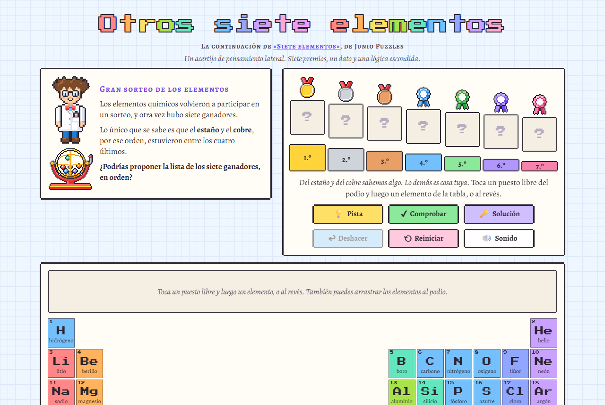

# Otros siete elementos

Un acertijo de pensamiento lateral. Los elementos químicos vuelven a un sorteo con siete premios, y solo se sabe que el
estaño y el cobre, por ese orden, estuvieron entre los cuatro últimos. ¿Quiénes fueron los siete, y en qué orden?
Juego web autónomo en un único `index.html`.

**Jugar:** https://spyder-cripto.github.io/otros-siete-elementos/

## Cómo se juega
- Toca una casilla libre del podio y después un elemento de la tabla periódica, o al revés. En el ordenador también
  puedes arrastrar.
- Un elemento no puede ganar dos veces.
- Cuando tengas los siete, el juego te dirá si la lista vale, pero no qué casilla falla.
- **Pista** te ayuda un poco más cada vez que la pulsas. **Solución** enseña la lista.
- Solo vale una lista: la que sigue la lógica del sorteo.

## Créditos
- Basado en el acertijo [«Siete elementos»](https://juniopuzzles.wordpress.com/2026/10/25/siete-elementos/), de Junio Puzzles.
- Variante, arte y textos: **Spider** (Fali + Claude), 2026.
